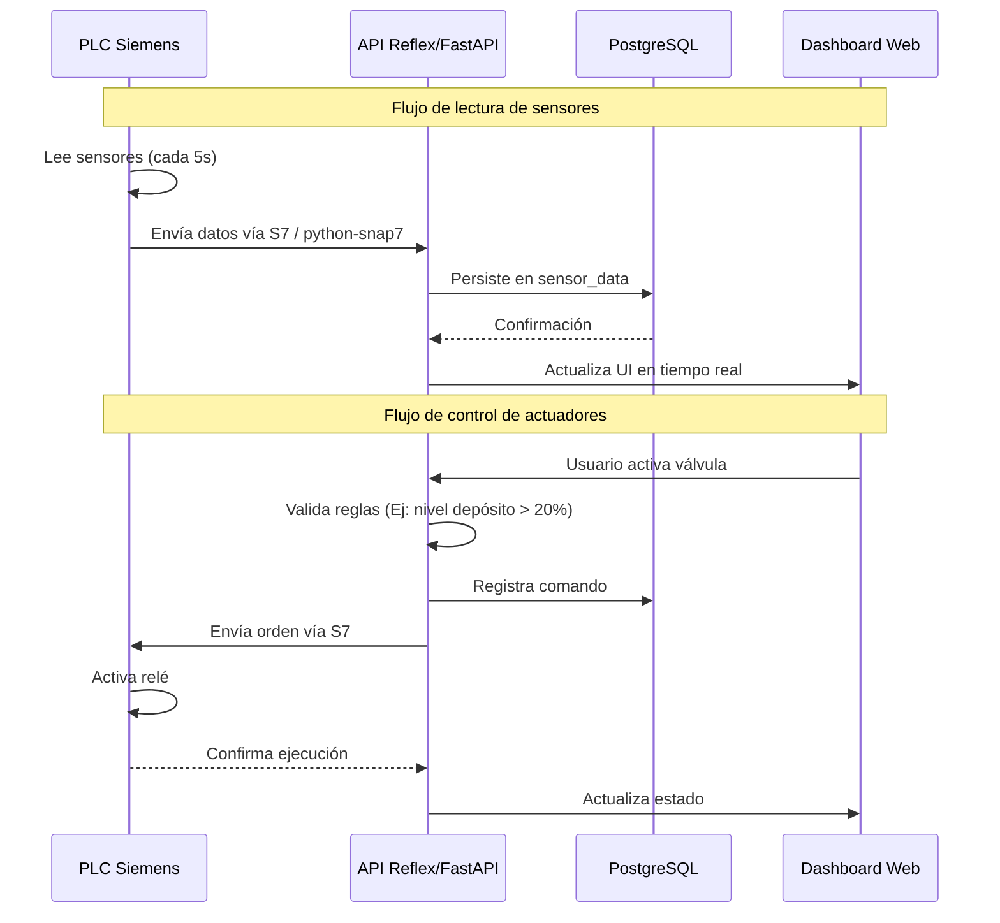

# II Reto Agrotech 

## Proyecto: Sistema Inteligente de Riego y Monitorización

[](https://www.gnu.org/licenses/gpl-3.0)
[](https://www.python.org/downloads/)
[](https://reflex.dev/)
[](https://new.siemens.com)
[](https://agrotechstartup.com)

> **Equipo POKER 5** · II Reto Agrotech 2026

## Descripción

Este proyecto es una solución integral de monitorización y control automatizado para explotaciones agrícolas. El sistema integra sensores distribuidos en múltiples parcelas, monitoreados y controlados mediante un **PLC industrial Siemens**, con una aplicación web responsiva que permite visualizar datos en tiempo real y controlar actuadores de riego.

Desarrollado como parte del **II Reto Agrotech 2026**, este proyecto demuestra la integración entre:

-  **Tecnologías de Operación (OT)**: PLC Siemens programado con **TIA Portal V20**
-  **Tecnologías de Información (IT)**: Aplicación web en **Python + Reflex**
-  **Comunicación industrial**: Protocolo **S7** mediante `python-snap7`

El proyecto utiliza **sensores y actuadores reales** que transmiten los datos en tiempo real conectados directamente a un **PLC industrial**, a diferencia de otras propuestas basadas exclusivamente en simulaciones de software. 

Las sondas de temperatura, los sensores de humedad del suelo, el anemómetro, el transmisor de radiación y el sensor de nivel del depósito proporcionan mediciones físicas reales del entorno agrícola, mientras que la bomba de agua y las electroválvulas de riego ejecutan acciones físicas sobre el terreno. 

Toda la adquisición de datos y el control de actuadores se gestionan a través del PLC, que aplica lógica industrial con protecciones y enclavamientos de seguridad antes de enviar la información a la aplicación web. 

Esta integración entre el mundo físico y el digital y la comunicación bidireccional en tiempo real entre el mundo físico y la interfaz web convierte al proyecto en una solución completa, validada y lista para su uso en una **solución técnicamente viable y directamente desplegable** en una explotación agrícola real, no en un prototipo teórico.

---

##  Características Principales

### Monitorización en Tiempo Real
- **Temperatura**: 4 sensores PT100 (1 en cada parcela + 1 ambiente exterior)
- **Humedad del suelo**: 3 sensores (1 por finca)
- **Condiciones ambientales**: Anemómetro (velocidad del viento) y transmisor de radiación (energía total de la radiación solar)
- **Control de recursos**: Sensor de nivel para depósito de agua

### Control de Actuadores
- Bomba de agua principal con protección contra funcionamiento en seco
- 3 electroválvulas todo/nada para control individual (1 por parcela)
- Control manual desde la interfaz web y HMI
- Lógica de automatización inteligente (riego automático basado en umbrales)

### Sistema de Alertas
- Alertas automáticas cuando los valores superan umbrales configurables
- Protección de equipos (ej: la bomba no se activa si el nivel es < 20%)
- Historial de alertas consultable

### Interfaz Responsiva
- Dashboard optimizado para móvil, tableta y escritorio
- Visualización de datos históricos con gráficos
- Control bidireccional de actuadores

---

## Arquitectura del Sistema

```
┌─────────────────────────────────────────────────────────────────────────┐
│                        CAPA DE CAMPO (Hardware)                         │
├─────────────────────────────────────────────────────────────────────────┤
│                                                                         │
│   SENSORES                              ACTUADORES                      │
│   ├─ PT100 x4 (temperatura)             ├─ Bomba de agua (relé)         │
│   ├─ Humedad suelo x3                   ├─ Electroválvula P1 (relé)     │
│   ├─ Anemómetro (viento)                ├─ Electroválvula P2 (relé)     │
│   ├─ Transmisor radiación               └─ Electroválvula P3 (relé)     │
│   └─ Nivel depósito                                                     │
│                                                                         │
└────────────────────────────────┬────────────────────────────────────────┘
                                 │  Señales de 4-20mA / 0-10V/ digitales
                                 ▼
┌─────────────────────────────────────────────────────────────────────────┐
│                    CAPA DE CONTROL - PLC Industrial                     │
├─────────────────────────────────────────────────────────────────────────┤
│                                                                         │
│   ┌─────────────────────────────────────────────────────────────────┐   │
│   │   PLC Siemens · TIA Portal V20                                  │   │
│   │   ├─ Módulos I/O analógicos y digitales                         │  │
│   │   ├─ Lógica de automatización (protecciones, enclavamientos)    │  │
│   │   └─ Módulo Ethernet (protocolo S7)                             │  │
│   └─────────────────────────────────────────────────────────────────┘  │
│                                                                         │
└────────────────────────────────┬────────────────────────────────────────┘
                                 │  Protocolo S7 / TCP-IP (python-snap7)
                                 ▼
┌─────────────────────────────────────────────────────────────────────────┐
│                    CAPA DE APLICACIÓN (Software IT)                     │
├─────────────────────────────────────────────────────────────────────────┤
│                                                                         │
│   ┌──────────────────┐    ┌──────────────────┐    ┌─────────────────┐  │
│   │  python-snap7    │───▶│  API REST        │───▶│  Aplicación Web │  │
│   │  (comunicación   │    │  FastAPI         │    │  Reflex         │  │
│   │   con PLC)       │    │                  │    │  (Dashboard)    │  │
│   └──────────────────┘    └────────┬─────────┘    └─────────────────┘  │
│                                    │                                    │
└────────────────────────────────────┼────────────────────────────────────┘
                                     │  SQL
                                     ▼
┌─────────────────────────────────────────────────────────────────────────┐
│                    CAPA DE DATOS (Persistencia)                         │
├─────────────────────────────────────────────────────────────────────────┤
│                                                                         │
│                      ┌──────────────────────┐                           │
│                      │    PostgreSQL        │                           │
│                      └──────────────────────┘                           │
│                                                                         │
└─────────────────────────────────────────────────────────────────────────┘
```
### Flujo de datos (diagrama de secuencia)



##  Hardware y Software Utilizado

### Sensores

| Sensor | Cantidad | Función | Unidad |
|--------|----------|---------|--------|
| PT100 | 4 | Temperatura (3 fincas + ambiente) | °C |
| Sensor de Humedad | 3 | Humedad del suelo | % |
| Anemómetro | 1 | Velocidad del viento | m/s |
| Transmisor de radiación | 1 | Energía total de radiación solar | W/m² |
| Sensor de Nivel | 1 | Nivel del depósito de agua | % |

### Actuadores

| Actuador | Cantidad | Control | Función |
|----------|----------|---------|---------|
| Bomba de agua | 1 | Relé | Suministro principal |
| Electroválvula | 3 | Relé | Control de riego por parcela |

### Software y herramientas

| Componente | Tecnología | Versión |
|------------|------------|---------|
| Lenguaje | Python | 3.11+ |
| Framework web | Reflex | 0.4.0+ |
| API | FastAPI (integrado en Reflex) | - |
| Comunicación PLC | python-snap7 | - |
| Programación PLC | TIA Portal | V20 |
| Base de datos | PostgreSQL | - |
| Control de versiones | GitHub | - |
| Licencia | GPL v3 | - |

---

## Herramientas de Desarrollo

- **Python 3.11** o superior
- **pip** (gestor de paquetes de Python)
- **Git, GitHub**
- **PostgreSQL** instalado y corriendo
- **TIA Portal V20** (para modificar el programa del PLC)
- **PLC Siemens** con módulo Ethernet y protocolo S7 habilitado

---

## Instalación

>  [!WARNING]
> **Sección en construcción** — Puede contener información incompleta o estar pendiente de completar.

### 1. Clonar el repositorio

```bash
git clone https://github.com/juaansanchezz06/Agrotech-Burgos-Zafra.git
cd Agrotech-Burgos-Zafra
```

### 2. Crear entorno virtual

```bash
python -m venv venv
source venv/bin/activate      # Linux/Mac
venv\Scripts\activate         # Windows
```

### 3. Instalar dependencias

Dependencias principales:
```bash
pip install python-snap7 psycopg2-binary reflex
```

### 4. Configurar la base de datos


### 5. Configurar la comunicación con el PLC

Editar el archivo `config.py` con la IP del PLC:

```python
PLC_IP = "192.168.0.4"
PLC_RACK = 0
PLC_SLOT = 1
```

---

##  Ejecución
>  [!WARNING]
> **Sección en construcción** — Puede contener información incompleta o estar pendiente de completar.

### Iniciar la aplicación web


##  Estructura del Proyecto

>  [!WARNING]
> **Sección en construcción** — Puede contener información incompleta o estar pendiente de completar.

```
IIRetoAgrotech/
├── README.md
└── LICENSE

```

##  Lógica de Automatización

El sistema implementa reglas inteligentes para optimizar el riego:

- **Protección de bomba**: La bomba nunca se activa si el nivel del depósito es menor al 20%
- **Riego automático**: Si la humedad del suelo baja del 30% y el depósito tiene más del 30%, se activa el riego automáticamente
- **Alertas**: Notificaciones cuando valores críticos superan umbrales configurables
---

## Documentación Adicional

>  [!WARNING]
> **Sección en construcción** — Puede contener información incompleta o estar pendiente de completar.


- [Arquitectura del Sistema](docs/arquitectura.md)
- [Esquemas eléctricos](docs/esquemas_electricos.md)
- [Manual de Usuario](docs/manual_usuario.md)
- [Manual de Técnico](docs/manual_tecnico.md)

---

## Licencia

Este proyecto está licenciado bajo la **GNU General Public License v3.0** - ver el archivo [LICENSE](LICENSE) para más detalles.

---

## Equipo

### **POKER 5**

**II Reto Agrotech 2026**

Desarrollado con ❤️ usando Python, Reflex y TIA Portal V20.

---

**Nota**: Este proyecto es parte del II Reto Agrotech 2026.
Fecha de entrega: **8 de diciembre de 2026**
Presentación final: **16 de diciembre de 2026**
